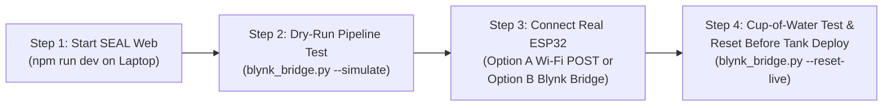

# SEAL — Smart Environment Aquaculture for Lobster
### 3-Sensor Marine Holding Tank Water-Quality Monitoring, Fuzzy Suitability & Forecasting System

[](https://nextjs.org/)
[](https://react.dev/)
[](https://www.typescriptlang.org/)
[-green)](https://en.wikipedia.org/wiki/Time_in_Indonesia)
[-0969da)](#1-sensor-suite--hardware-bom-decision-d7)

SEAL (**Smart Environment Aquaculture for Lobster**) is a real-time water-quality monitoring, literature-grounded fuzzy suitability inference, and classical time-series forecasting web application built for the **Telkom University Surabaya** campus marine holding tank (**Pearl Lobster, *Panulirus ornatus***).

---

## Table of Contents
1. [Sensor Suite & Hardware BOM (Decision D7)](#1-sensor-suite--hardware-bom-decision-d7)
2. [UI/UX Architecture & Synchronized 5s/24h Interaction (Decision D8)](#2-uiux-architecture--synchronized-5s24h-interaction-decision-d8)
3. [Quick Start (Local Development & Production Build)](#3-quick-start-local-development--production-build)
4. [Physical Bench-Test Playbook: How to Connect & Test IoT Before Tank Deployment](#4-physical-bench-test-playbook-how-to-connect--test-iot-before-tank-deployment)
5. [Choosing Your IoT Connection Option (Option A vs. Option B vs. Wokwi)](#5-choosing-your-iot-connection-option-option-a-vs-option-b-vs-wokwi)
6. [Time-Series Forecasting Pipeline (30 min – 6 h Ahead)](#6-time-series-forecasting-pipeline-30-min--6-h-ahead)
7. [Repository Layout](#7-repository-layout)

---

## 1. Sensor Suite & Hardware BOM (Decision D7)

Per the finalized Electrical Engineering hardware scope (`PLANS.md` §2 & Decision D7), automated ESP32 telemetry logs **3 probes only** via an **ESP32S CH340** microcontroller and **ADS1115 16-bit I2C ADC**:

| Schema Column (`POST /api/readings`) | Hardware Probe (EE BOM) | Unit | Optimum ($\mu = 1$) | Trapezoid $(a, b, c, d)$ | Literature Source |
|---|---|---|---|---|---|
| `temperature_c` | **DS18B20** Waterproof (1-Wire digital) → ESP32 GPIO | °C | `25.0 – 31.0 °C` | `(19, 25, 31, 32)` | Jones (2009), *J World Aquac Soc* 40(6):744–752 *(19 °C `NEEDS_SOURCE`)* |
| `ph` | **PH-4502C** + electrode → **ADS1115** Channel A0 | pH | `7.80 – 8.40 pH` | `(7.0, 7.8, 8.4, 8.5)` | KepMen LH No. 51/2004 (7.0–8.5) & marine culture guideline |
| `turbidity_ntu` | **Turbidity Red Board** (optical) → **ADS1115** Channel A1 | NTU | `≤ 5.0 NTU` | `(-∞, -∞, 5.0, 25.0)` | KepMen LH No. 51/2004 marine clarity standard *(25 NTU `NEEDS_SOURCE`)* |

- **Manual & Mechanical Life Support (Excluded from Automated Schema, Rule R3)**:
  - **Salinity**: Checked manually by staff with an optical refractometer (indicated via badge in `Current Conditions`).
  - **Dissolved Oxygen (DO)**: Maintained continuously by the 24/7 campus blower.
  - **Organic / Ammonia Load**: Managed by the 24/7 protein skimmer (no automated ammonia sensor).
- **Overall Suitability (Decision D5)**: $\mu = \min(\mu_{\text{temp}}, \mu_{\text{pH}}, \mu_{\text{turbidity}})$ → **Optimal** ($\mu = 1.0$), **Warning** ($0 < \mu < 1$), **Critical** ($\mu = 0.0$).

---

## 2. UI/UX Architecture & Synchronized 5s/24h Interaction (Decision D8)

- **Spacious Full-Bleed Top `PondHeroVisualizer` Stage**:
  - Sits at the very top of `Overview`, spanning 100% full width left-to-right (`74vh` height) with a smooth `150px` bottom gradient fade into `var(--bg-canvas)` and zero layout bleeding.
  - Top-right pill switches between `Static 3D`, `Video`, `Off`, `5s Live Graph`, and `24h Chart`.
- **Synchronized `Current Conditions` Shelf & Interactive Graph**:
  - Directly beneath the Pond Hero fade sit 3 compact horizontal sensor cards (`Temperature`, `pH`, `Turbidity`) with a **`5s Live` | `24h`** window toggle.
  - **State-Aware Card-to-Graph Opening**: When `Current Conditions` is set to **`5s Live`**, clicking any sensor card opens and focuses that sensor's **5-second live graph**. When set to **`24h`**, clicking any sensor card opens and focuses that sensor's **24-hour + forecast graph**.
- **Simplified 2-Tab Navigation + Responsive Mobile Drawer**:
  - Desktop navbar shows **`Overview`** and **`About`** (which reveals a horizontal segmented sub-menu bar: `Forecast | Water Quality | Alerts | History | Device`).
  - Mobile screens (`≤ 768px`) feature a slide-down **Mobile Navigation Drawer** with 1-tap access to all views, theme switching, and stream pause/resume.
- **WCAG AA/AAA Popular Themes**: **GitHub Primer Light** and **GitHub Dark** palettes with `Auto | Light | Dark` toggle.

---

## 3. Quick Start (Local Development & Production Build)

```powershell
cd C:\Users\nurul\projects\SEAL\seal
npm install

# (Optional) Regenerate 3-sensor forecast JSON from placeholder or live CSV
python "src/app/(core)/forecast.py"

# Start development server at http://localhost:3000
npm run dev

# Or build & start production server
npm run build
npm run start
```

---

## 4. Physical Bench-Test Playbook: How to Connect & Test IoT Before Tank Deployment

Before submerging the probes in the campus lobster tank, run this **4-step physical bench test** on a table with the Electrical Engineering team:



### Step 1 — Start the SEAL Web Server on Your Laptop
Open **Terminal 1** in `C:\Users\nurul\projects\SEAL\seal`:
```powershell
npm run dev
```
Open `http://localhost:3000`. Notice the top-left badge currently says **`PLACEHOLDER · 3 SENSORS · GMT+7`** (because `data/readings.csv` does not exist yet).

### Step 2 — Run a 10-Second Software Dry-Run (Verify `/api/readings` Works)
Open **Terminal 2** in `C:\Users\nurul\projects\SEAL\seal` and run the built-in bench simulator:
```powershell
python scripts/blynk_bridge.py --simulate --count 3 --interval 2
```
**What you will see:**
1. Terminal 2 prints `POST HTTP 201` for 3 consecutive readings and verifies `GET /api/readings -> mode='live'`.
2. `seal/data/readings.csv` is automatically created with exact columns `timestamp,temperature_c,ph,turbidity_ntu`.
3. On `http://localhost:3000`, the top-left badge automatically flips from `PLACEHOLDER` to green **`LIVE · 3 SENSORS · GMT+7`**!

### Step 3 — Physical Cup-of-Water Bench Test with EE's Hardware
Prepare 3 small cups on the bench before going to the lobster tank:
1. **Temperature Test**: Hold the **DS18B20** steel tip in your fingers or dip in warm water (`~30–33 °C`) → verify `temperature_c` rises on the SEAL `5s Live Graph` and triggers `Warning` above `31.0 °C`.
2. **pH Buffer Test**: Dip the **PH-4502C** probe in `pH 6.86` neutral buffer (should trigger `Critical` because marine target is `7.8–8.4`), then rinse and dip in `pH 8.1` seawater/alkaline buffer (should turn `Optimal`).
3. **Turbidity Test**: Place the **Turbidity Red Board** probe in clear water (`< 5.0 NTU` → `Optimal`), then stir in a drop of milk/sediment (`> 5.0 NTU` → `Warning`).
4. **Disconnected Probe Null-Safety Test (Rule R10)**: Unplug one sensor jumper wire; confirm the payload sends `null` (not `0`) and the CSV stores an empty cell.

### Step 4 — Archive Bench-Test Data Before Real Tank Deployment
Once the bench test passes, archive the cup-of-water test rows so they do **not** mix with your 2-week real lobster tank dataset (Rule R1 & R10):
```powershell
python scripts/blynk_bridge.py --reset-live
```
This moves `data/readings.csv` to `data/readings_bench_backup.csv` and returns the dashboard to clean readiness for tank deployment.

---

## 5. Choosing Your IoT Connection Option (Option A vs. Option B vs. Wokwi)

Full wiring, code snippets, and troubleshooting are in **[docs/HARDWARE_BRIDGE_GUIDE.md](../docs/HARDWARE_BRIDGE_GUIDE.md)**. Here is how to run each option:

### Option A (Recommended): Direct ESP32 Wi-Fi HTTP Push (Can Run Alongside Blynk!)
Use this when you can flash (or ask EE to add 15 lines to) the ESP32S CH340 sketch.
1. Connect both your **Laptop** and the **ESP32** to the **same mobile hotspot or dedicated router** (avoids campus Wi-Fi AP isolation).
2. Find your laptop's IPv4 address in PowerShell:
   ```powershell
   ipconfig
   ```
   *(Look for `IPv4 Address` under Wireless LAN adapter Wi-Fi, e.g. `192.168.137.1` or `192.168.1.15`.)*
3. In the ESP32 Arduino sketch (see complete sketch in [docs/HARDWARE_BRIDGE_GUIDE.md](../docs/HARDWARE_BRIDGE_GUIDE.md#4-option-a-recommended-direct-dual-push-from-esp32-httpclient--blynk)), set:
   ```cpp
   const char* SEAL_API_URL = "http://192.168.1.15:3000/api/readings";
   ```
4. Flash the ESP32 and open the Arduino Serial Monitor (`115200` baud). Every 5 seconds you will see:
   ```text
   [SEAL] HTTP 201 | {"temperature_c":27.85,"ph":8.12,"turbidity_ntu":1.40}
   ```

### Option B (Zero Changes to EE's Firmware!): Blynk Cloud → SEAL Bridge
Use this if EE has **already flashed Blynk** on the ESP32 and you do not want to re-flash their board.
1. Ask EE for their **Blynk Auth Token** and which **Virtual Pins** hold Temperature, pH, and Turbidity (e.g. `v0`, `v1`, `v2`).
2. Keep `npm run dev` running in Terminal 1, and in Terminal 2 run:
   ```powershell
   python scripts/blynk_bridge.py --token "PASTE_EE_BLYNK_TOKEN" --temp-pin v0 --ph-pin v1 --turb-pin v2 --interval 5
   ```
3. `blynk_bridge.py` polls `https://blynk.cloud/external/api/get` every 5 seconds and pushes the 3 sensor values directly into `http://localhost:3000/api/readings`!
   *(For the 2-week tank capture, change `--interval 5` to `--interval 300` for 5-minute logging.)*

### Option C: Wokwi Virtual Simulator (No Physical Hardware Needed)
If you want to test the C++ firmware logic in your browser before EE hands over the board:
1. Expose your local SEAL server over HTTPS using Cloudflare Quick Tunnel:
   ```powershell
   cloudflared tunnel --url http://localhost:3000
   ```
2. Paste the `https://xxxx.trycloudflare.com/api/readings` URL into the Wokwi ESP32 sketch (`WIFI_SSID = "Wokwi-GUEST"`).

---

## 6. Time-Series Forecasting Pipeline (30 min – 6 h Ahead)

- **Resampling (Decision D2)**: Raw 5-minute readings are aggregated into **30-minute medians** ($\ge 3$ valid readings per bin; internal gaps $\le 3\text{ h}$ linearly interpolated; coarser spacing refused per Rule R4).
- **Chronological 60 / 20 / 20 Split (Rules R5–R8)**:
  - **Temperature (`temperature_c`)**: `ARIMA + daily harmonics` `(2, 1, 2)`
  - **Acidity (`ph`)**: `ARIMA + daily harmonics` `(1, 1, 1)`
  - **Turbidity (`turbidity_ntu`)**: `VAR + daily harmonics` (3-sensor multivariate, clipped at $\ge 0\text{ NTU}$)
- **Refresh Forecasts Anytime**:
  ```powershell
  python "src/app/(core)/forecast.py"
  ```

---

## 7. Repository Layout

```text
SEAL/
├── docs/
│   └── HARDWARE_BRIDGE_GUIDE.md      # Complete ESP32 C++, Blynk Bridge & Wokwi handbook
├── seal/                             # Next.js 16.4.6 Application Root
│   ├── data/
│   │   ├── readings.csv              # Live 3-sensor ESP32 log (created automatically on first POST)
│   │   ├── sensor_log_placeholder.csv# 25,920 5-min synthetic 3-sensor rows (Rule R1)
│   │   ├── accuracy_test.csv         # Per-sensor MAE/RMSE/Skill vs Persistence
│   │   ├── status_forecast_test.csv  # Status forecast accuracy/F1 vs Persistence
│   │   └── forecast.json             # 30m – 6h forecast payload
│   ├── scripts/
│   │   └── blynk_bridge.py           # Blynk Cloud poller, bench dry-run simulator & log reset CLI
│   ├── src/
│   │   ├── app/
│   │   │   ├── (core)/               # Python 3-sensor preprocessing, modelling & forecast CLI
│   │   │   ├── api/readings/route.ts # POST / GET /api/readings endpoint (Rules R3 & R10)
│   │   │   ├── lib/                  # water.ts (3-sensor fuzzy rules), data.ts, format.ts
│   │   │   └── styles/styles.css     # Unified WCAG Primer Light/Dark & Full-Bleed Hero CSS
│   │   └── components/
│   │       ├── dashboard/            # PondHeroVisualizer, CurrentConditionsCard, TrendChart, etc.
│   │       └── layout/               # Navbar (with Mobile Drawer) & Dashboard orchestrator
│   ├── PLANS.md                      # Master specification, §3 Hard Rules & §14 Decision Log
│   └── README.md                     # This file
└── Claude_3/                         # 3-Sensor Research Notebooks (01–04) & Datasets
```
