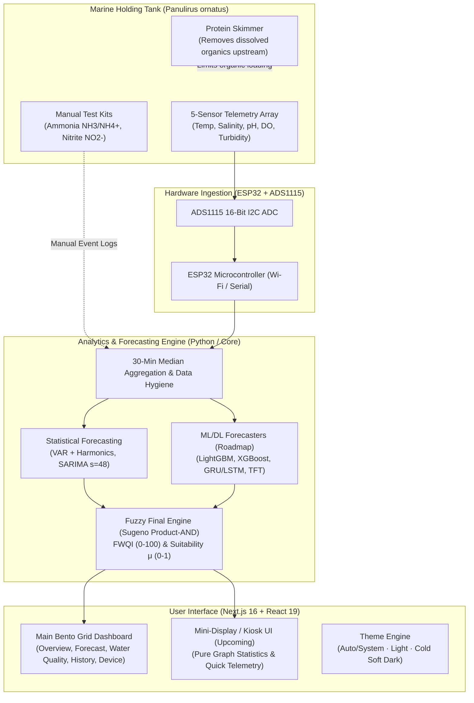
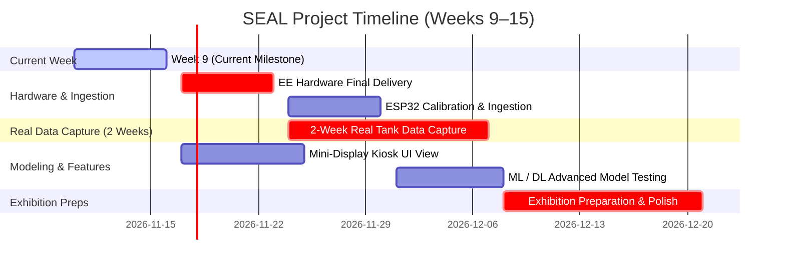

# SEAL — Smart Environment Aquaculture for Lobster
### Marine Holding Tank Water-Quality Monitoring & Forecasting System

[](https://nextjs.org/)
[](https://react.dev/)
[](https://www.typescriptlang.org/)
[](https://tailwindcss.com/)
[-green)](https://en.wikipedia.org/wiki/Time_in_Indonesia)
[-orange)](#biological-profile--target-species)

SEAL (**Smart Environment Aquaculture for Lobster**) is an end-to-end water-quality monitoring, literature-grounded fuzzy suitability inference, and multi-horizon time-series forecasting platform designed specifically for holding tanks of **Pearl Lobster (*Panulirus ornatus*)**.

---

## Table of Contents
1. [Overview & System Architecture](#overview--system-architecture)
2. [Sensor Suite & Hardware Configuration](#sensor-suite--hardware-configuration)
3. [Biological Profile & Literature Fuzzy Rules](#biological-profile--literature-fuzzy-rules)
4. [Time-Series Forecasting Engine](#time-series-forecasting-engine)
5. [Frontend Dashboard Features](#frontend-dashboard-features)
6. [Getting Started & Installation](#getting-started--installation)
7. [Repository Layout](#repository-layout)
8. [Pending Roadmap & Project Milestones (Weeks 9–15)](#pending-roadmap--project-milestones-weeks-915)

---

## Overview & System Architecture



SEAL continuously ingests 5 physicochemical water parameters, applies zero-order Sugeno product-AND fuzzy inference to evaluate water suitability according to published biological literature, and forecasts future conditions (30 min to 6 hours ahead) so operators can intervene **before** critical thresholds are reached.

---

## Sensor Suite & Hardware Configuration

In accordance with the project hardware budget (`RAB_CAPSTONE.xlsx`), the telemetry array uses 5 cost-effective, high-durability probes logged via an **ESP32** microcontroller coupled with an **ADS1115 16-bit I2C ADC**:

| Parameter | Sensor Model | Operating Unit | Optimal Range (*P. ornatus*) | Alert Behavior |
|---|---|---|---|---|
| **Temperature** | DS18B20 (Waterproof digital probe) | °C | 25.0 – 31.0 °C (Peak: 27.0 °C) | Warning < 25°C or > 31°C; Critical > 32°C |
| **Salinity** | DFRobot Analog EC (K=10 probe) | ppt / mS/cm | 30.0 – 34.0 ppt | Warning < 30 or > 34 ppt; Critical < 25 or > 38 ppt |
| **pH** | PH-4502C + Industrial pH electrode | pH scale | 7.80 – 8.40 | Warning < 7.80 or > 8.40; Critical < 7.00 or > 9.00 |
| **Dissolved Oxygen (DO)**| DFRobot SEN0237 Galvanic DO probe | mg/L (% sat) | ≥ 5.00 mg/L (≥ 80% saturation) | Warning < 5.0 mg/L; Critical < 3.5 mg/L |
| **Turbidity** | Analog Turbidity Sensor (NTU) | NTU | ≤ 5.0 NTU (KepMen LH 51/2004) | **Warning only (μ=0.5)**; Never Critical (Decision D7) |

> [!IMPORTANT]
> **Rule R15 — Ammonia & Water Treatment Clarification**:
> There is **no online ammonia sensor** in the tank. The tank utilizes an industrial **protein skimmer** that extracts dissolved organics *before* they decompose into total ammonia nitrogen (TAN). 
> **Turbidity is NOT a proxy for ammonia**. Online status indicators cover only the 5 monitored parameters. Manual colorimetric/photometric test kit readings (NH3/NH4+, NO2-) are recorded via the events logging system (`events.csv`).

---

## Biological Profile & Literature Fuzzy Rules

### Target Species: Pearl Lobster (*Panulirus ornatus*)
- **Growth & Thermal Biology**: *P. ornatus* thrives in tropical marine environments (Jones, 2009; Sachlikidis et al., 2005). Optimum growth occurs at **27 °C**, with acceptable growth between **25–31 °C**, and upper non-lethal threshold at **32 °C**.
- **Salinity Tolerances**: Optimum salinity is **30–34 ppt** (marine stenohaline with limited euryhaline tolerance).
- **Water Clarity**: KepMen LH No. 51/2004 marine biota guidelines stipulate coral/lobster waters should remain **≤ 5.0 NTU**.

### Fuzzy Water-Quality Index (FWQI) & Suitability
SEAL implements a deterministic Sugeno zero-order fuzzy evaluation:
1. **Parameter Suitabilities ($\mu_i \in [0, 1]$)**: Calculated via trapezoidal membership functions for Temperature, Salinity, pH, and Dissolved Oxygen; step-function for Turbidity.
2. **Fuzzy Water-Quality Index (FWQI)**:
   $$\text{FWQI} = 100 \times \left(\prod_{i=1}^5 \mu_i\right)^{1/5}$$
3. **Fuzzy Status**:
   $$\mu_{\min} = \min_{i} \mu_i \implies \begin{cases} \text{Optimal}, & \mu_{\min} \ge 0.80 \\ \text{Warning}, & 0.40 \le \mu_{\min} < 0.80 \\ \text{Critical}, & \mu_{\min} < 0.40 \end{cases}$$

---

## Time-Series Forecasting Engine

SEAL features a multi-horizon forecasting pipeline (30m, 1h, 3h, 6h ahead):
- **Aggregation**: Raw 5-minute telemetry is cleaned and downsampled to 30-minute median bins ($\ge 3$ valid readings per bin required).
- **Validation Winners (Notebook 02)**:
  - **Temperature, pH, Dissolved Oxygen, Turbidity**: Multi-lag **Vector Autoregression (VAR)** with daily harmonics ($lags=6$).
  - **Salinity**: Seasonal Autoregressive Integrated Moving Average (**SARIMA** $(1,1,1)\times(1,0,1)_{48}$).
- **Baseline Discipline (Rule R7)**: All forecasters are evaluated against the **Persistence ("Next = Last Value")** baseline across RMSE, MAE, $R^2$, and Skill Score.
- **Physical Guard-Rails**: Non-negative physical limits (e.g. `turbidity_ntu >= 0`) and fallback persistence for out-of-bounds extrapolations.

---

## Frontend Dashboard Features

Built on **Next.js 16 (Turbopack)** and **React 19**:
- **Bento Grid Architecture**: High-density, professional layout with zero unnecessary empty space.
- **5-Second Live Stream Monitoring**: Real-time polling ticker displaying seconds-until-next-sync with manual pause/resume controls.
- **Interactive Dual-Mode Trend Charts**: SVG charts supporting both 5-second live streams and 24-hour historical/forecast series, hover inspections, and zero gradient lag.
- **3D Holding Tank Hero Visualizer**: Seamless visual viewport supporting 3D video loop, 3D isometric still image, and minimal telemetry-only off mode.
- **Theme Engine**: Segmented control supporting **Auto (Device System)**, **Light (Studio Bento)**, and **Cold Soft Dark (Slate/Ice-Blue)** with zero hydration flicker.
- **Species & Probe Metadata**: Live biological guidelines, RAB probe model notes, and scientific citations prominently displayed.

---

## Getting Started & Installation

### Prerequisites
- **Node.js**: `v20.x` or `v22.x+`
- **Python**: `3.10+` (with `numpy`, `pandas`, `statsmodels`, `scipy`)

### 1. Clone & Install Dependencies
```bash
git clone https://github.com/ADMHipper20/SEAL.git
cd SEAL/seal
npm install
```

### 2. Run Python Forecast Pipeline (Optional if using cached JSON)
```bash
python -m src.app.(core).forecast
```

### 3. Launch Development Server
```bash
npm run dev
```
Open [http://localhost:3000](http://localhost:3000) in your browser.

### 4. Build for Production
```bash
npm run build
npm run start
```

---

## Repository Layout

```
SEAL/
├── seal/                             # Next.js Application Root
│   ├── data/                         # CSV and JSON data stores
│   │   ├── sensor_log_placeholder.csv# 25,920 5-min synthetic readings (v2 Turbidity)
│   │   ├── accuracy_test.csv         # Model accuracy scorecard vs persistence
│   │   ├── status_forecast_test.csv  # Status forecast evaluation across test origins
│   │   └── forecast.json             # Computed multi-step forecast payload
│   ├── src/
│   │   ├── app/
│   │   │   ├── (core)/               # Python forecasting & data pipeline
│   │   │   │   ├── preprocessing.py  # 30-min median aggregation & hygiene
│   │   │   │   ├── modelling.py      # Statistical VAR & SARIMA model classes
│   │   │   │   └── forecast.py       # Forecast generation CLI script
│   │   │   ├── api/readings/         # Next.js telemetry ingestion API route
│   │   │   ├── lib/                  # TypeScript domain models, data & water logic
│   │   │   │   ├── water.ts          # Fuzzy inference, FWQI, species boundaries
│   │   │   │   ├── data.ts           # Snapshot loading & alert synthesis
│   │   │   │   └── format.ts         # Formatting & timezone utilities (GMT+7)
│   │   │   ├── styles/styles.css     # Unified Bento Grid & Dark Neo theme CSS
│   │   │   ├── layout.tsx            # App root layout with theme hydration script
│   │   │   └── page.tsx              # Main dashboard entry
│   │   └── components/
│   │       ├── dashboard/            # Bento cards & views
│   │       │   ├── OverviewView.tsx
│   │       │   ├── CurrentConditionsCard.tsx
│   │       │   ├── TrendChart.tsx
│   │       │   ├── PondHeroVisualizer.tsx
│   │       │   ├── BentoStockMetricsCard.tsx
│   │       │   ├── BentoAlertsList.tsx
│   │       │   ├── ForecastView.tsx
│   │       │   ├── WaterQualityView.tsx
│   │       │   ├── HistoricalDataView.tsx
│   │       │   └── DeviceStatusView.tsx
│   │       └── layout/
│   │           ├── Navbar.tsx        # Top bar with 3-way theme toggle & live stream pill
│   │           └── Dashboard.tsx     # Client state orchestrator & live polling
│   └── package.json
├── Claude_2/                         # Research Notebooks & Experiments
│   ├── 01_data_exploration_and_plots.ipynb
│   ├── 02_model_training_evaluation.ipynb  # Statistical model validation
│   ├── 03_experimental_models.ipynb        # Statistical experimental models
│   ├── 04_ml_dl_behind_fuzzy.ipynb         # Machine learning / Deep learning experiments
│   └── ml_dl_scorecard.csv
└── PLANS.md                          # Master specification, hard rules & decision log
```

---

## Pending Roadmap & Project Milestones (Weeks 9–15)



### 1. Dedicated Mini-Display / Kiosk UI View (Pending Task 1)
- **Objective**: Develop a dedicated, ultra-clean UI route (`/mini` or `/kiosk`) tailored for small secondary screens (e.g., 7"–10" touch displays or a tank-side mini LCD).
- **Core Requirements**:
  - Focus purely on real-time statistical curves, parameter cards with min/max envelopes, and the live FWQI gauge.
  - Stripped of heavy video/image assets, navigation headers, or dense metadata tables.
  - Full-screen responsive auto-scaling for kiosk form factors.

### 2. Electrical Engineering Device Delivery & Critical 2-Week Capture Window (Pending Task 2)
- **Current Position**: **Week 9** (mid-November 2026).
- **Hard Deadline for EE Team**: **End of Week 10 / Start of Week 11** (firm cutoff: **November 23, 2026**).
- **Mandatory 2-Week Real Data Logging**:
  - The system requires **at least 2 continuous weeks (Weeks 11–12 / 13)** of uninterrupted logging from the live Pearl Lobster tank.
  - **Risk**: Hardware delivery *cannot slip into Week 12 or 13*; otherwise, the 2-week baseline will overlap with exhibition preparation.
- **Week 14–15 Milestone**: **Capstone Exhibition & Live Demo** (requiring a fully operational live-logging rig and trained model snapshot).

### 3. Advanced Model Exploration Beyond Traditional Statistical Methods (Pending Task 3)
While classical statistical models (VAR + SARIMA) provide a solid statistical baseline, the project roadmap includes testing and benchmarking Machine Learning & Deep Learning architectures once real tank data arrives:
- **Tree-Based / Gradient Boosted Models**:
  - **LightGBM & XGBoost**: Fast tabular training, rolling window feature extraction, lag-based physical interactions.
  - **Random Forest Regressor**: Non-linear variance baseline.
- **Deep Sequence Architectures**:
  - **Gated Recurrent Unit (GRU) & Long Short-Term Memory (LSTM)**: Capturing diurnal biological cycles and feeding response curves.
  - **Dilated 1D-CNN (WaveNet style)**: Capturing multi-scale temporal receptive fields without autoregressive inference drift.
  - **Temporal Fusion Transformer (TFT)**: Interpretable multi-horizon forecasting with attention over historical dynamics.
- **Hybrid Approaches**:
  - Classical statistical baseline (VAR) for macroscopic trend + LightGBM / GRU for residual anomaly correction.
- **Architectural Constraint (Rule R17)**:
  - All ML/DL models will output **future sensor physical values only**; the crisp FWQI and status determination remain strictly governed by the literature-grounded fuzzy inference engine.

### 4. TimescaleDB & Production Ingestion (Pending Task 4)
- Transition from static CSV files to a live TimescaleDB hypertable (`readings`) and relational `events` table with continuous 30-minute aggregates.
- Automated weekly retraining and model checkpointing gates based on validation skill.
